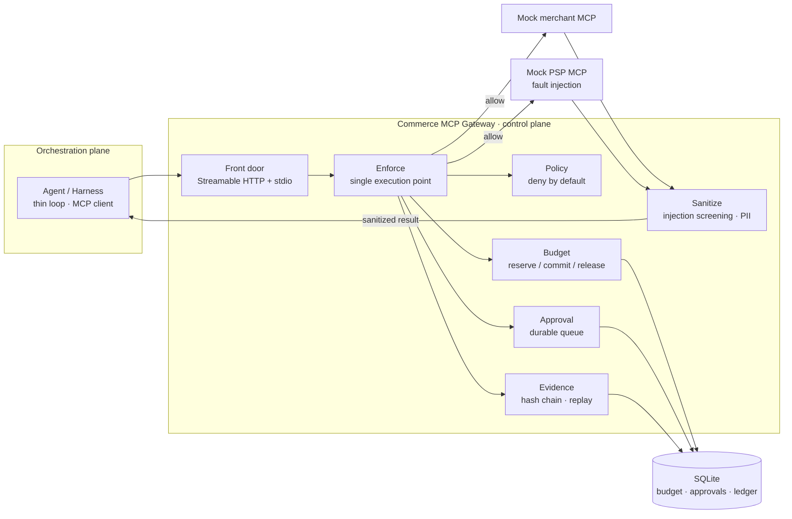

<div align="center">

# Commerce MCP Gateway

**A control plane that enforces authorization, budget, approval and audit between an agent and commerce/payment MCP servers.**

It turns "is this call valid?" into "is the whole transaction valid?"

[](https://github.com/HugoOu/commerce-mcp-gateway/actions/workflows/ci.yml)
[](LICENSE)
[](https://www.python.org/)
[](https://modelcontextprotocol.io/)

[中文](README.md) · [English](README.en.md)

</div>

> A **demo** governance gateway for **agentic commerce and AI payments**. It turns the control plane of an agent harness into executable, testable and reconstructable code rather than an architecture diagram. It is not a production payment gateway, and it does not claim to stop prompt injection on its own.

## Why this exists

An agent can make every individual tool call look valid while the whole transaction is wrong:

- complete an order before capturing payment;
- capture only the item subtotal and skip shipping and tax;
- create two payment intents for one checkout;
- split one authorization into several purchases;
- complete an order with a forged, guessable payment token;
- let a merchant change the quote from 49.99 to 60.00 at completion.

These are not "one call had a bad argument" failures. The **cross-call transaction context** is missing. This project writes five invariants into the execution path and leaves a test or an explicit boundary note for each of them.

## Where it sits in an agent harness

| Plane | Typical responsibilities | This project |
| --- | --- | --- |
| **Orchestration plane** | agent loop, model calls, tool selection, context | a thin driver (~100 lines) used to put the gateway in a real loop |
| **Control plane** | authorization, budget, approval, audit, policy enforcement | **the main subject** |

That separation makes a question explicit: **who may spend the user's money, on what basis, and what proves it afterwards?**

## Architecture



Every intercepted method call follows one path:

```text
authorize → decide → enforce → record_pending → forward
          → sanitize → settle → record_done
```

`record_pending` is persisted before forwarding, so **evidence precedes side effects**. There is no second write path around `enforce`.

## Five invariants

| ID | Invariant | Current evidence |
| --- | --- | --- |
| **I1** | No method call is allowed without a Decision | single execution point, layering contract, T1–T9, 139 passed / 1 xfailed |
| **I2** | `sum(committed) + sum(active holds) ≤ limit` | 50 concurrent reserves, 0 overspend |
| **I3** | Tampering with any evidence record must fail verification | 4/4 tamper cases detected; clean chain passes |
| **I4** | A run package can reconstruct its decision sequence | 6/6 reconstructable; the chain still verifies after replay inputs are removed |
| **I5** | Cross-call transaction consistency: one active intent per checkout, capture before complete, amount and token binding, mandate transaction limit | implemented for the demo; **single process only** |

I5 was added after a state-attack probe showed that I1–I4 can all hold while the transaction is still free, underpaid or double-charged. The discovery and the fix are documented in [evaluation](docs/evaluation.md) and [decisions](docs/decisions.md).

## What is enforced

- **Deny by default** for tools, merchants, amounts and resource URIs outside policy;
- **Two-phase budget**: `reserve → commit / release`, SQLite WAL, an in-process single writer and database constraints;
- **Approval bound to the action**: native `input_required` / MRTR with a CLI fallback; approvals carry `action_hash`; legacy clients fail closed;
- **Verifiable evidence**: hash chain plus run package with a Merkle root; the chain stores digests while replay inputs live separately;
- **Transaction guard**: one active intent per checkout, payment amount bound to the cart total, a successful capture before completion, a PSP-issued token, and a per-mandate transaction limit;
- **Output sanitization**: scans string leaves in both `content` and `structuredContent`, flags suspected injection and redacts PII;
- **Dual-era transport**: Streamable HTTP and stdio; modern and handshake-era clients both connect.

## Quick start

Requires Python 3.12 and [uv](https://docs.astral.sh/uv/).

```bash
git clone https://github.com/HugoOu/commerce-mcp-gateway.git
cd commerce-mcp-gateway
uv sync

# deterministic demo; no model key required
uv run python scripts/play.py scenario
uv run python scripts/smoke_mocks.py

# quality gates
uv run pytest -q          # 139 passed, 1 xfailed
uv run ruff check
```

Inspect the gateway manually:

```bash
uv run python -m gateway serve
uv run python scripts/play.py tools
uv run python -m gateway approvals
uv run python -m gateway verify
```

Run a live model against an OpenAI-compatible endpoint:

```powershell
$env:OPENAI_API_KEY = "your-key"
$env:OPENAI_BASE_URL = "https://opencode.ai/zen/go/v1"
$env:MODEL_NAME = "deepseek-v4.1-flash"
uv run python scripts/run_w2_demo.py
```

```bash
# macOS / Linux
export OPENAI_API_KEY="your-key"
export OPENAI_BASE_URL="https://opencode.ai/zen/go/v1"
export MODEL_NAME="deepseek-v4.1-flash"
uv run python scripts/run_w2_demo.py
```

`scripts/run_w2_demo.py` starts the mock merchant/PSP, boots the gateway, runs the agent loop and prints the gateway evidence log.

## Demo (CLI only)

One command runs the happy path, both denial layers, the recorded F14 trajectory, approval and audit:

```bash
uv run python scripts/demo.py          # about 5 minutes; no model key
uv run python scripts/demo.py --fast   # about 70 seconds
uv run python scripts/demo.py --deep   # adds the historical guard-off probe
uv run python scripts/demo.py --json   # machine-readable result
```

F14 is a real `qwen3.8-27b` trajectory replay: exploratory N=5, 2/5 is the attempt rate, the attack success rate is 0/5, and there are 0 double charges. The full narration, expected output and recording guide are in [demo.en.md](docs/demo.en.md).

## Evaluation summary

Evaluation is organized **claim first**: define the decision rule, then ask whether the evidence supports the claim.

| Claim | Evidence | Status |
| --- | --- | --- |
| Every intercepted call passes a Decision | T1–T9, three bypass channels, layering contract, 139 passed / 1 xfailed | supported |
| Budget does not overspend under concurrency | 50 concurrent reserves, 0 overspend, holds reclaimed | supported |
| Approval is bound to the action | form / CLI / legacy fail-closed, `action_hash` | supported |
| Evidence is tamper-evident and reconstructable | 4/4 tamper checks, 6/6 reconstruction | supported |
| Over-limit attempts are denied end to end | scripted adversary: amount over-limit 30/30, complete-before-capture 30/30, 0 bypass | supported (compromised-harness control) |
| Concurrent duplicate intents are serialized | 30/30 duplicates before fix → 0/30 after, 0 orphans | supported (single process) |
| A model attempts a transaction-level violation | F14: 2/5 attempt a split purchase, 2/2 denied, baseline 0/5 | **exploratory, N=5** |
| Merchant content can move model beliefs | P2: baseline 0/30 vs injected 30/30 | model-layer finding, not a gateway claim |

## Honest boundaries

- **Single process**: the transaction guard keeps state in memory. A restart resets `max_transactions`; in the restart probe a second purchase was allowed 10/10 times. SQLite or shared state is future work.
- **Price drift**: when checkout says 49.99 and the order becomes 60.00, 5/5 runs underpaid. The gateway currently trusts the merchant-reported checkout total; a signed quote or a completion-time total check is future work.
- **Prompt injection**: keyword screening catches obvious injections, not semantic manipulation. F8 (Branded Whisper) is a known residual.
- **Model-layer evidence is not gateway evidence**: the belief probe shows the model treating a merchant claim as fact; it neither proves nor disproves the gateway.
- **F14 is N=5 exploratory**: do not turn it into a stable 40% attempt rate.
- **Deployment boundary**: if an agent bypasses the gateway and calls the PSP HTTP endpoint directly, the gateway cannot stop it. That is a deployment problem, not an in-protocol control.

## Project layout

```text
src/gateway/       control plane: frontdoor / policy / enforce / budget / approval / evidence / sanitize
src/agent/         thin driver: MCP client + replaceable ModelClient
src/mcp_servers/   mock merchant, mock PSP, fault injection
eval/              experiments, probes, statistics and red-team scripts
scripts/           demo and smoke scripts
demo/              CLI demo and the sanitized F14 fixture
tests/             unit, integration, adversarial and invariant tests
docs/              architecture, decisions, threat model, evaluation and reproduction notes
```

## Documentation

| Document | Chinese | English |
| --- | --- | --- |
| Architecture | [architecture.md](docs/architecture.md) | [architecture.en.md](docs/architecture.en.md) |
| Evaluation | [evaluation.md](docs/evaluation.md) | [evaluation.en.md](docs/evaluation.en.md) |
| Threat model | [threat-model.md](docs/threat-model.md) | [threat-model.en.md](docs/threat-model.en.md) |
| Risk decisioning | [risk-decisioning.md](docs/risk-decisioning.md) | [risk-decisioning.en.md](docs/risk-decisioning.en.md) |
| Architecture decisions | [decisions.md](docs/decisions.md) | [decisions.en.md](docs/decisions.en.md) (index) |
| Demo | [demo.md](docs/demo.md) | [demo.en.md](docs/demo.en.md) |
| Code tour | [code-tour.md](docs/code-tour.md) | Chinese |
| Mock world | [mock-world.md](docs/mock-world.md) | Chinese |
| Red-team log | [redteam-log.md](docs/redteam-log.md) | Chinese |
| Experiment design | [w4-experiment-design.md](docs/w4-experiment-design.md) | Chinese |

## License

MIT. See [LICENSE](LICENSE).

---

<div align="center">

If this project helps you, a star is appreciated.

</div>
