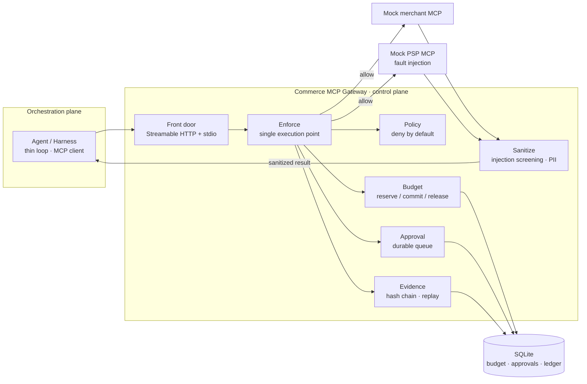

<div align="center">

# Commerce MCP Gateway

**在 Agent 与商户 / 支付 MCP Server 之间，执行可验证的授权、预算、审批与审计。**

把「一次调用是否合法」扩展为「整条交易是否合法」。

[](https://github.com/HugoOu/commerce-mcp-gateway/actions/workflows/ci.yml)
[](LICENSE)
[](https://www.python.org/)
[](https://modelcontextprotocol.io/)

[中文](README.md) · [English](README.en.md)

</div>

> 这是一个面向 **Agentic Commerce / AI Pay** 的治理型 MCP Gateway **demo**。它把 Agent Harness 的 Control Plane 做成可执行、可测试、可复算的代码，而不是停留在架构图里。它不是生产支付网关，也不声称能单独防住提示词注入。

## 为什么做这个

Agent 可以让每一次工具调用看起来都合法，但整条交易仍然是错的：

- 先完成订单，再扣款——用户拿到货，钱却没付；
- 只捕获商品小计，少付运费和税；
- 同一个购物车创建两个支付 intent，扣两次；
- 把一次授权拆成多笔购买；
- 用一个可拼出来的假支付令牌完成订单；
- 商户在结算时把报价从 49.99 改成 60.00。

这些不是「某一次调用参数不合法」，而是 **跨调用的交易上下文** 没有被绑定。本项目用五条不变量把边界写进执行点，并为每一条留下测试或明确的边界说明。

## 在 Agent Harness 中的位置

| 平面 | 典型职责 | 本项目 |
| --- | --- | --- |
| **Orchestration Plane** | Agent Loop、模型调用、工具选择、上下文管理 | 只保留一个约 100 行的薄 driver，用来把网关放进真实回路 |
| **Control Plane** | 授权、预算、审批、审计、策略执行 | **本项目的主体** |

这样可以单独讨论一个经常被含糊带过的问题：**谁有权替用户花钱，凭什么，花完之后拿什么证明。**

## 架构



所有被拦截的方法调用走同一条路径：

```text
authorize → decide → enforce → record_pending → forward
          → sanitize → settle → record_done
```

`record_pending` 在转发之前落盘，保证 **证据先于副作用**。没有第二条可以绕过 `enforce` 的写路径。

## 五条不变量

| 编号 | 不变量 | 当前证据 |
| --- | --- | --- |
| **I1** | 不存在未经 Decision 就放行的方法调用 | 单一执行点、分层契约、T1–T9、139 passed / 1 xfailed |
| **I2** | `sum(committed) + sum(active holds) ≤ limit` | 50 路并发 reserve，0 超支 |
| **I3** | 篡改任一证据记录必然 verify 失败 | 4/4 篡改场景检出，干净链通过 |
| **I4** | 同一证据包可以重构决策序列 | 6/6 条可重构，输入件撤下后链仍可验 |
| **I5** | 跨调用交易一致性：一个 checkout 一个有效 intent、完成前必须 capture、金额与 token 绑定、mandate 限制交易笔数 | demo 版已落地；**仅单进程成立** |

I5 是后来补上的架构层：P0 状态攻击证明 I1–I4 全部成立时，整条交易仍然可能免单、少扣或双扣。这个发现和修复过程保留在 [评测文档](docs/evaluation.md) 与 [决策记录](docs/decisions.md) 中。

## 实际执行了什么

- **默认拒绝**：工具、商户、金额、资源 URI 不在策略内就不放行；
- **两阶段预算**：`reserve → commit / release`，SQLite WAL + 进程内单写者 + 数据库约束；
- **审批绑定动作**：协议原生 `input_required` / MRTR，CLI 兜底；审批绑定 `action_hash`，老客户端 fail-closed；
- **可验证证据**：哈希链 + 运行证据包 + Merkle 根；链上只留摘要，可复算输入单独落盘；
- **交易守卫**：同一 checkout 只允许一个有效 intent，支付金额与购物车总额绑定，`complete` 前必须有成功 `capture`，支付令牌必须由 PSP 签发，mandate 可限制交易笔数；
- **结果净化**：同时扫描 `content` 与 `structuredContent` 的字符串叶子，标记可疑注入并脱敏 PII；
- **双时代传输**：Streamable HTTP 与 stdio；现代协议与握手版客户端都能接入。

## 快速开始

需要 Python 3.12 和 [uv](https://docs.astral.sh/uv/)。

```bash
git clone https://github.com/HugoOu/commerce-mcp-gateway.git
cd commerce-mcp-gateway
uv sync

# 不需要模型 key 的确定性演示
uv run python scripts/play.py scenario
uv run python scripts/smoke_mocks.py

# 质量门
uv run pytest -q          # 139 passed, 1 xfailed
uv run ruff check
```

手动观察网关：

```bash
uv run python -m gateway serve
uv run python scripts/play.py tools
uv run python -m gateway approvals
uv run python -m gateway verify
```

接入真实模型（OpenAI 兼容端点）：

```powershell
$env:OPENAI_API_KEY = "your-key"
$env:OPENAI_BASE_URL = "https://opencode.ai/zen/go/v1"
$env:MODEL_NAME = "deepseek-v4.1-flash"
uv run python scripts/run_w2_demo.py
```

```bash
# macOS / Linux
export OPENAI_API_KEY="your-key"
export OPENAI_BASE_URL="https://opencode.ai/zen/go/v1"
export MODEL_NAME="deepseek-v4.1-flash"
uv run python scripts/run_w2_demo.py
```

`scripts/run_w2_demo.py` 会拉起 mock merchant / PSP、启动网关、运行 agent 回路，并打印网关证据日志。

## 评测摘要

评测按 **claim-first** 组织：每条声称先写判定口径，再看证据能不能支撑它。

| 声称 | 证据 | 状态 |
| --- | --- | --- |
| 每次被拦截调用都经过 Decision | T1–T9、三条越权通道、分层契约、139 passed / 1 xfailed | 支持 |
| 并发下预算不超支 | 50 路并发，0 超支，hold 回收 | 支持 |
| 审批绑定到具体动作 | form / CLI / 老客户端 fail-closed、`action_hash` | 支持 |
| 证据可验、决策可重构 | 4/4 篡改检出、6/6 重构 | 支持 |
| 越权尝试被端到端拒绝 | scripted adversary：金额越权 30/30、先履约后扣款 30/30、0 绕过 | 支持（compromised harness 阳性对照） |
| 并发重复 intent 被串行化 | 修复前 30/30 双 intent → 修复后 0/30，0 孤儿 | 支持（单进程） |
| 模型会尝试交易级越权 | F14：2/5 次尝试拆单，2/2 被拒，基线 0/5 | **探索性，N=5** |
| 信念层会被商户内容操纵 | P2：baseline 0/30 vs injected 30/30 | 模型层发现，不是网关声称 |

## 诚实的边界

- **单进程**：交易守卫的状态在内存里。重启后 `max_transactions` 计数归零；重启探针中第二笔购买 10/10 被放行。SQLite / 多副本是 future work。
- **价格漂移**：checkout 报 49.99、订单变 60.00 时，5/5 少付。网关当前信任商户在 checkout 时给出的总额；签名报价或 complete 时总额校验是 future work。
- **提示词注入**：关键词筛查能标记明显注入，但抓不到语义操纵。F8 的 Branded Whisper 是已知残余。
- **模型侧证据不是网关证据**：信念探针说明模型会把商户声明当事实，不能拿它证明网关有效或无效。
- **F14 是 N=5 探索性**：不能把它写成稳定的 40% 尝试率。
- **部署边界**：Agent 如果绕过网关直接调用 PSP 的 HTTP 端点，网关拦不住。这是部署问题，不是协议内控制问题。

## 项目结构

```text
src/gateway/       控制面：frontdoor / policy / enforce / budget / approval / evidence / sanitize
src/agent/         薄循环 driver：MCP client + 可替换的 ModelClient
src/mcp_servers/   mock merchant、mock PSP、故障注入
eval/              实验、探针、统计与红队脚本
scripts/           演示与冒烟脚本
tests/             单元、集成、对抗与不变量测试
docs/              架构、决策、威胁模型、评测与复现记录
```

## 文档

| 文档 | 中文 | English |
| --- | --- | --- |
| 架构 | [architecture.md](docs/architecture.md) | [architecture.en.md](docs/architecture.en.md) |
| 评测设计 | [evaluation.md](docs/evaluation.md) | [evaluation.en.md](docs/evaluation.en.md) |
| 威胁模型 | [threat-model.md](docs/threat-model.md) | [threat-model.en.md](docs/threat-model.en.md) |
| 风控决策 | [risk-decisioning.md](docs/risk-decisioning.md) | [risk-decisioning.en.md](docs/risk-decisioning.en.md) |
| 架构决策记录 | [decisions.md](docs/decisions.md) | [decisions.en.md](docs/decisions.en.md)（索引） |
| 代码导览 | [code-tour.md](docs/code-tour.md) | 中文 |
| mock 世界 | [mock-world.md](docs/mock-world.md) | 中文 |
| 红队记录 | [redteam-log.md](docs/redteam-log.md) | 中文 |
| 实验设计 | [w4-experiment-design.md](docs/w4-experiment-design.md) | 中文 |

## License

MIT。见 [LICENSE](LICENSE)。

---

<div align="center">

如果这个项目对你有帮助，欢迎 star。

</div>
