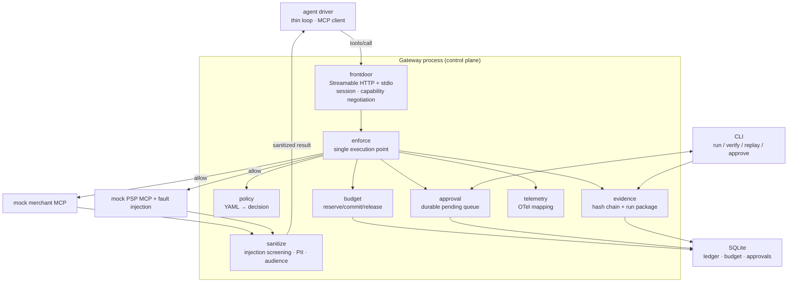

# Architecture

[中文](architecture.md) · English

> This is the architecture that the implementation is checked against. Changes require evidence and an explicit decision recorded in `docs/decisions.md`.

## 1. Positioning

A policy-enforcement and audit gateway between an agent and commerce/payment MCP servers. It makes two questions executable, auditable and reconstructable inside the kernel: **may this agent call this tool, and may it spend this money?**

## 2. Eight design choices

1. **The gateway is a standalone MCP server process, not a library.** A protocol boundary forces explicit handling of transport, sessions and capability negotiation; it can be observed and restarted independently, and it is easy to demo. The cost is that forwarding must be written by hand: the Python SDK v2 has no built-in proxy, and its server class is `MCPServer`.
2. **One execution point.** Every intercepted method call (`tools/*`, `resources/*`, including `prompts/get`; see ADR-0011) must pass through `authorize → decide → enforce → record_pending → forward → sanitize → settle → record_done`, with no side path. This is invariant I1: "no method call is allowed without a Decision." `record_pending` runs before forwarding, so evidence precedes side effects (ADR-0022).
3. **A Decision is a first-class object.** `Decision = allow | deny(reason_code) | require_approval(approval_id) | transform(patch)`. Policy produces it, evidence records it, replay compares it.
4. **Deterministic core, side effects at the edge.** Policy evaluation, budget arithmetic, sanitization and evidence hashing are pure functions. Time, randomness, upstream responses and user approval are recorded inputs. That is what makes replay possible.
5. **Two-phase budget.** `reserve → commit / release`, backed by a single SQLite file (WAL), an in-process single writer and database constraints.
6. **Two evidence shapes.** A global hash chain (one row per call, including denies) and a run package (JSONL + manifest + Merkle root).
7. **Approval is a durable wait.** A pending approval is persisted and survives restart. Delivery channels are the CLI and MCP elicitation.
8. **Observability converges in one module.** OTel MCP semantic conventions are still evolving (semconv already has deprecated entries); attribute mapping lives in `telemetry/mapping.py`.

## 3. Architecture diagram

## 4. Layer responsibilities

| Layer | Component | Responsibility |
| --- | --- | --- |
| Client | agent driver (thin loop) | connects to the gateway as an MCP client and produces `tools/call` |
| Front door | `frontdoor/` | MCP server endpoint (Streamable HTTP + stdio), capability-negotiation passthrough, request metadata, long-lived streams (`subscriptions/listen`). Note: 2026-07-28 has no protocol-level session (`Mcp-Session-Id`, standalone GET stream and `Last-Event-ID` recovery are gone) |
| Decision | `policy/` | policy loading (YAML → pydantic → in-memory decision structures), evaluation and Decision construction |
| Execution | `enforce/` | the single execution point (covering `tools/*` and `resources/*`), applying the Decision, deny-by-default, the sole owner of upstream clients |
| Budget | `budget/` | reserve/commit/release, idempotency keys, TTL reclamation, restart reconciliation |
| Result handling | `sanitize/` | injection screening, PII redaction, audience filtering |
| Approval | `approval/` | durable pending queue, CLI and elicitation delivery |
| Evidence | `evidence/` | hash-chain ledger, run package, verify and replay |
| Telemetry | `telemetry/` | OTel spans/metrics and attribute mapping |
| Upstream | `mcp_servers/` | mock merchant, mock PSP, fault injection |
| Storage | `store/` | SQLite (ledger, budget, approvals) |

## 5. Timeline of an intercepted request (`tools/call`)

1. The front door receives JSON-RPC and resolves agent identity and session.
2. `policy.evaluate(agent, tool, args)` → Decision.
3. `deny`: write evidence (including `reason_code`) and return a structured error; do not forward.
4. `require_approval`: persist the pending approval, notify, wait with a bound, then turn it into allow or deny.
5. `allow`: `budget.reserve`, then **write `record_pending` evidence** before forwarding (decision, policy version and digest, budget before/after).
6. Forward upstream and obtain the result.
7. `sanitize(result)`: injection screening / PII redaction / audience filtering.
8. `budget.commit` (or `release` on failure).
9. Write `record_done` evidence (upstream request and response digests, sanitization flags, final budget state) and emit a span.
10. Return the result to the agent.

> Rule: **evidence before side effects**. `record_pending` must be persisted before forwarding, so even if the process crashes during the side effect, the ledger contains a record that a Decision authorized it. External precedent: JanuScope registers `audit` first in its pipeline (ADR-0022).

> `resources/read`, `resources/list` and `resources/subscribe` use the same chain. The difference is in steps 6 and 7: `resources/list` must filter by URI and **re-sign cursors** (ADR-0013); subscription notifications must go through the same checks on the stream.

## 6. Four testable invariants and one candidate

| ID | Invariant | How it is tested |
| --- | --- | --- |
| I1 | No method call is allowed without a Decision (covering `tools/*` and `resources/*`) | the execution point is the only entry; instrumentation tests and an import-linter layering contract prove there is no side path |
| I2 | Concurrency safety: `sum(committed) + sum(active holds) ≤ limit` | N=50 concurrent load |
| I3 | Tamper evidence: modifying any record makes `verify` fail | flip one byte and it must be detected |
| I4 | Reconstructability: replaying the same package reproduces the decision sequence | replay determinism rate |
| **I5 (candidate, 2026-10-19)** | **Transaction consistency**: for one consent/checkout, completion requires cumulative capture equal to the cart total (or an explicit partial fulfilment), completion requires a successful capture, one checkout has one active intent, and a mandate can cap the number of transactions | implemented as a demo in ADR-0029; **single process only** |

**I5 versus I1–I4.** I1–I4 are per-call or session-level invariants. I5 is a cross-call, transaction-level invariant. The P0 gap was not a regression of I1–I4: no-side-path, budget bound, chain verification and reconstruction all still held in the P0 scenarios. What was missing was "how many charges should this one consent produce, and which authoritative total should they match?"

**Architecture gap or implementation bug?** The main cause was that the architecture did not define transaction-level invariants: it positioned the gateway as per-call authorization + session budget + audit, without a `checkout → intent → capture → order` state machine. Two implementation shortcuts turned the gap into an exploitable one: (1) the mock merchant token was checked only with `startswith` / `endswith`; (2) the `complete_checkout` policy did not require a prior capture. The accurate statement is: **the architecture omitted I5, and the implementation used simplifications that were exploitable enough**; it is not "the implementation violated a promised transaction invariant," because that invariant did not exist before.

## 7. Three type classes: constructed / validated / passthrough

The gateway handles protocol types in exactly three ways. The class determines whether fields must be read and which tests are required.

| Class | Contents | Required tests |
| --- | --- | --- |
| Constructed | denial responses, approval requests (`input_required`), filtered lists, self-signed cursors, evidence records | golden (a real MCP client can parse the constructed message) + reverse validation with pydantic |
| Validated | tool arguments (amount / merchant), content types to sanitize | negative (invalid arguments rejected) + boundary cases (amount exactly at the limit, merchant exactly on the allowlist) |
| Passthrough | everything else (prompts, sampling, envelope fields) | round-trip (in equals out, unknown fields preserved) + digest stability (same logical message, different serialization → same digest) |

Four obligations for passthrough: **preserve unknown fields** (otherwise it becomes a compatibility break); **normalize only fields declared as constructed**; **record a canonical digest after key sorting** (otherwise replay produces false failures); **still pass through the execution point** — passthrough is one possible Decision result, not a way around a Decision (I1).

**This classification is versioned.** An ADR can promote a type from passthrough to constructed. One case has already happened: `resources/list` became constructed under ADR-0011 and ADR-0013 (URI filtering + cursor re-signing). Keep three explicit lists in code so promotions are visible in diffs (ADR-0014).

## 8. Relationship to other documents

- The three design decisions (policy language boundary, budget semantics, evidence semantics) and their alternatives are in `docs/decisions.md`.
- Threat-to-control mapping is in `docs/threat-model.md`.
- The staged development plan remains in the private development record and is not part of the public repository.
