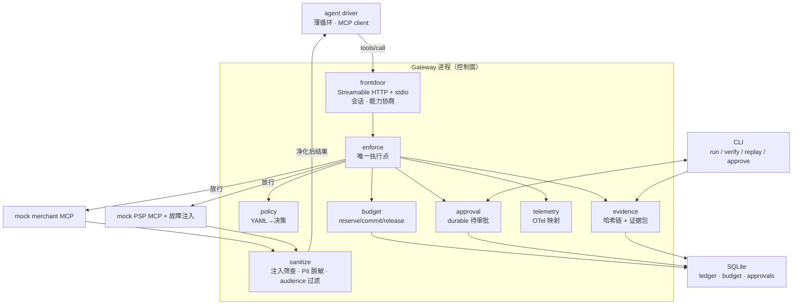

# 架构（先验架构全文）

[中文](architecture.md) · [English](architecture.en.md)

> 本文件由 AI 从既有的架构讨论转写（2026-10-05），**内容与讨论结论一致，未改动架构本身**。
> 架构变更流程见 `AGENTS.md`：需充分证据、User 明确认可，并记入 `docs/decisions.md`。

## 1. 定位

一个位于 agent 与 commerce/pay MCP server 之间的策略执行与审计网关：让「agent 能不能调用这个工具、能不能花这笔钱」成为内核里可执行、可留痕、可复算的边界。

## 2. 八条切分理由

1. **网关做成独立 MCP server 进程，不做成库。** 协议边界强制显式处理传输、会话与能力协商；可独立观测与重启；演示直观。代价是转发要自己写（已核实：Python SDK v2 无内置代理，服务端类为 `MCPServer`）。
2. **单一执行点。** 所有被拦截的方法调用（`tools/*`、`resources/*`，含 `prompts/get`；见 ADR-0011）必经 authorize → decide → enforce → **record_pending** → forward → sanitize → settle → **record_done**，无旁路。这构成可测试不变量 I1：「不存在未经 Decision 就放行的方法调用」；而 `record_pending` 在 forward 之前，保证「证据先于副作用」（见 ADR-0022）。
3. **决策是一等公民。** `Decision = allow | deny(reason_code) | require_approval(approval_id) | transform(patch)`。策略输出它、证据记录它、重放比对它。
4. **确定性核心 + 副作用边缘。** 策略求值、预算算术、脱敏、证据哈希为纯函数；时间、随机、上游响应、用户审批作为被记录的输入。这是可复算重放的前提。
5. **两阶段预算。** reserve → commit / release，配单文件 SQLite（WAL）+ 进程内单写者，DB 约束兜底。
6. **证据双形态。** 全局哈希链（每次调用一条，含 deny）+ 运行证据包（JSONL + manifest + Merkle 根）。
7. **审批是 durable wait。** 待审批记录落库，重启后仍有效；投递通道为 CLI 与 MCP elicitation。
8. **可观测性收敛到一个模块。** OTel MCP 语义约定仍在演进（semconv 已有 deprecated 条目），属性映射集中在 `telemetry/mapping.py`。

## 3. 架构示意

## 4. 分层职责

| 层 | 组件 | 职责 |
| --- | --- | --- |
| 客户端 | agent driver（薄循环） | 以 MCP client 身份连网关，产出 tools/call |
| 网关前门 | `frontdoor/` | MCP server 端点（Streamable HTTP + stdio）、能力协商透传、请求元数据头处理、长连接（`subscriptions/listen`）。注：2026-07-28 已无协议级会话（无 `Mcp-Session-Id`、无 GET 独立流、无 `Last-Event-ID` 恢复） |
| 判定 | `policy/` | 策略加载（YAML→pydantic→内存决策结构）、求值、Decision 构造 |
| 执行 | `enforce/` | 单一执行点（覆盖 tools/* 与 resources/*），落实 Decision；deny-by-default；唯一持有上游客户端 |
| 预算 | `budget/` | reserve/commit/release、幂等键、TTL 回收、重启对账 |
| 结果处理 | `sanitize/` | 注入筛查、PII 脱敏、audience 过滤 |
| 审批 | `approval/` | durable 待审批队列、CLI 与 elicitation 投递 |
| 证据 | `evidence/` | 哈希链账本、证据包、verify 与 replay |
| 观测 | `telemetry/` | OTel span/指标 + 属性映射 |
| 上游 | `mcp_servers/` | mock merchant、mock PSP、故障注入 |
| 存储 | `store/` | SQLite（ledger、budget、approvals） |

## 5. 一次被拦截请求的时序（以 tools/call 为例）

1. 前门收到 JSON-RPC，解析出 agent 身份与会话
2. `policy.evaluate(agent, tool, args)` → Decision
3. deny：写证据（含 reason_code）→ 返回结构化错误（不转发）
4. require_approval：落库待审批 → 通知 → 有界等待 → 转为 allow 或 deny
5. allow：`budget.reserve` → **写 `record_pending` 证据**（转发前落盘：decision、policy 版本与摘要、预算前后）
6. 转发上游 → 取结果
7. `sanitize(结果)`：注入筛查 / PII 脱敏 / audience 过滤
8. `budget.commit`（或失败时 release）
9. 写 `record_done` 证据（上游请求与响应摘要、脱敏标记、最终预算状态）+ 发 span
10. 返回结果给 agent

> 规则：**证据先于副作用**——`record_pending` 必须在转发之前落盘，这样即使进程在副作用中途崩溃，账本里也一定留下「有一条 Decision 授权过它」的记录（外部佐证：JanuScope 把 `audit` 注册在管道最前，见 ADR-0022）。

> `resources/read`、`resources/list`、`resources/subscribe` 走同一条链；差异在步骤 6 与 7——`resources/list` 需要按 URI 过滤并**重签游标**（ADR-0013），订阅通知需要在流上做同等检查。

## 6. 四条可测试不变量 + 一条候选（简历上的数字来源）

| 编号 | 不变量 | 测法 |
| --- | --- | --- |
| I1 | 不存在未经 Decision 就放行的方法调用（覆盖 tools/* 与 resources/*） | 执行点是唯一入口；插桩测试 + import-linter 分层契约证明无旁路 |
| I2 | 并发安全：`sum(committed) + sum(active holds) ≤ limit` | N=50 并发压测 |
| I3 | 防篡改：篡改任一记录 verify 失败 | 翻转一个字节必须被检出 |
| I4 | 可复算：同一证据包重放决策序列逐条一致 | 重放确定性率 |
| **I5（候选，2026-10-19）** | **交易一致性**：同一 consent / checkout 的资金与履约会话满足「完成时累计捕获 = 购物车总额（或显式部分履约）」「complete 前必须有成功 capture」「一个 checkout 一个有效 intent」「mandate 的交易笔数上限」 | 当前**未实现**；`eval/p0_state_attacks.py` 已给出六个反例（免单、少扣、双扣、拆单、先履约后扣款、伪造 token） |

**I5 与 I1–I4 的关系**：I1–I4 是 **per-call / 会话级**不变量；I5 是 **跨调用、交易级**不变量。P0 的缺口不是 I1–I4 的回归——I1（无旁路）、I2（预算不超）、I3（链可验）、I4（可重构）在 P0 场景里都仍然成立。缺的是「这一次同意到底该产生几次扣款、金额该和哪个权威总额对齐」。

**这是架构缺口还是实现失误？** 主因是**架构范围没有定义交易级不变量**：原设计把网关定位为 per-call 授权 + 会话预算 + 审计，没有承诺 `checkout → intent → capture → order` 的状态机。两个实现捷径把缺口放大成可利用漏洞：① mock merchant 的 token 只做 `startswith` / `endswith` 字符串检查；② `complete_checkout` 的 policy 规则没有要求「先 capture」。所以正确的说法是：**架构漏了 I5，实现在 token 与 complete 两处用了足以被利用的简化**；不是「实现违背了某条已承诺的交易不变量」——那条不变量此前根本不存在。

## 7. 类型三分类：构造 / 校验 / 透传

网关对协议类型只有三种处理方式。这一分类决定了「要不要读它的字段」，也决定了「要写什么测试」：

| 分类 | 内容 | 必须有的测试 |
| --- | --- | --- |
| 构造 | 拒绝响应、审批请求（`input_required`）、过滤后的列表、自签游标、证据记录 | golden（构造出的报文能被真实 MCP client 解析）+ 用 pydantic 反向校验自己构造的对象 |
| 校验 | 工具参数（金额 / 商户）、要净化的内容类型 | negative（非法参数被拒）+ 边界用例（金额刚好等于上限、商户刚好在白名单） |
| 透传 | 其余全部（prompts、sampling、信封字段等） | round-trip（进出一致、未知字段不丢）+ digest 稳定性（同一逻辑报文不同序列化 → 同一摘要） |

透传的四条义务：**保留未知字段**（否则成为兼容性断点）；**只规范化声明为构造的字段**；**记录键排序后的规范化摘要**（否则重放假失败）；**仍须过执行点**——透传是 Decision 的一种结果，不是绕过 Decision 的通道（见 I1）。

**这一分类是版本化的**：ADR 变更可能把类型从透传升级为构造。已发生一例：`resources/list` 因 ADR-0011 与 ADR-0013 升级为构造（按 URI 过滤 + 重签游标）。建议在代码里显式维护三张清单，使升级在 diff 里可见（见 ADR-0014）。
## 8. 与其它文档的关系

- 三个设计决定（策略语言边界、预算语义、证据语义）的取舍与备选写在 `docs/decisions.md`。
- 威胁与挂点的对应写在 `docs/threat-model.md`。
- 分阶段计划保留在开发记录中（未随公开仓库发布）。
